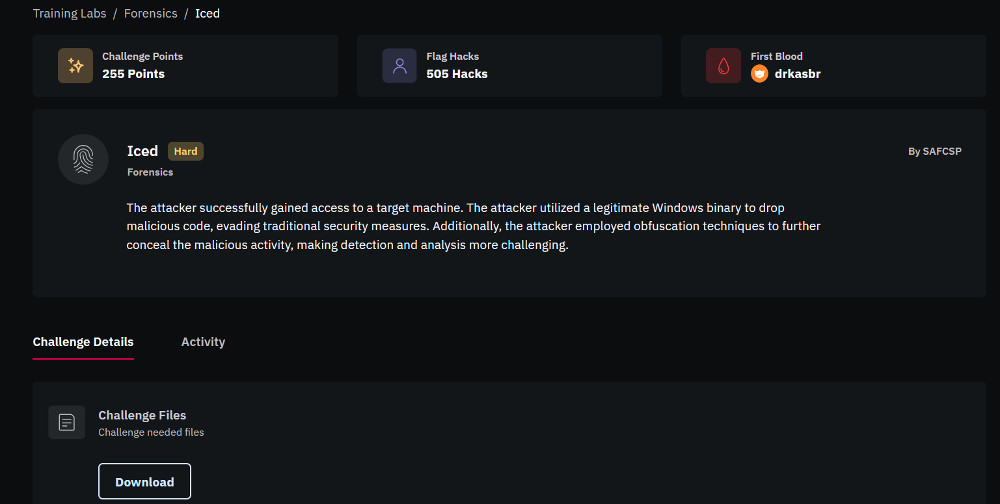

# Iced-Challenge--Python-Solver

A simple Python script created to help deobfuscate the PowerShell payload used in the **ICED** challenge from **FlagYard CTF**.




## Video


## Description

The script helps deobfuscate the PowerShell payload by:

- Extracting the format string and its arguments.
- Reconstructing the obfuscated string using `-f`.
- Removing the `Cvx` and `+` obfuscation.
- Outputting the deobfuscated PowerShell command for further analysis.

## Usage

Run the script and provide the obfuscated PowerShell file:

```bash
python3 solve.py script.ps1
```

The script outputs the **deobfuscated PowerShell command**, which can then be analyzed manually to identify and decode the Base64 payload.

> This script is created for educational and CTF purposes.
```
